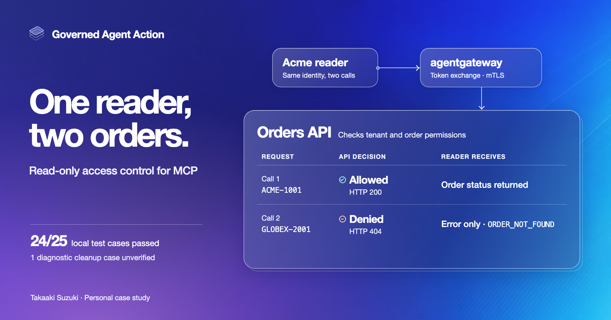

# One reader, two orders.

Could a lookup error reveal that another customer’s order exists?

[Read the case study](https://ihatovremains.github.io/gaa-read-access-case-study/) · [Test results](https://ihatovremains.github.io/gaa-read-access-case-study/#results) · [One-page PDF](https://ihatovremains.github.io/gaa-read-access-case-study/gaa-read-access-case-study.pdf)

Personal, read-only prototype with synthetic orders. Unaffiliated with my employer. The prototype’s source code and original run records are private.
